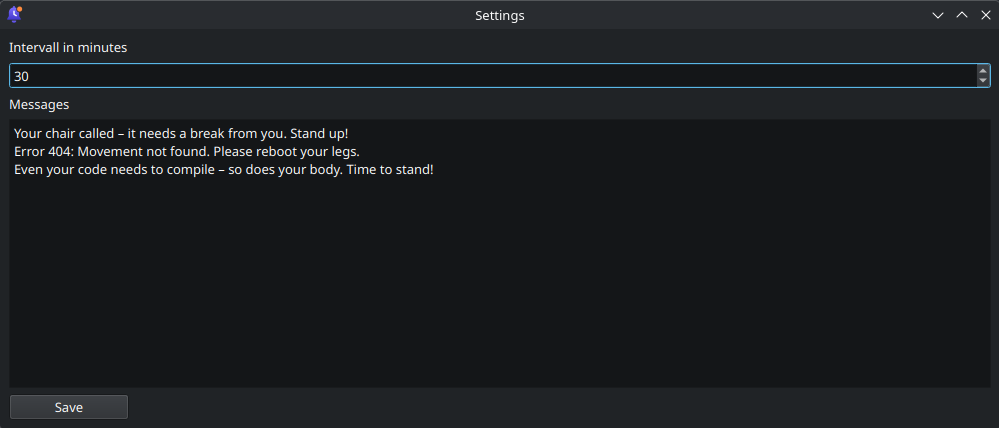

# Remynder

Remynder ist eine kleine Anwendung, die dich regelmäßig erinnert.
Die Grundidee stammt aus einer Erinnerung, ab und an vom Schreibtisch aufzustehen.

Die Anwendung nutzt PyQt6 und supportet light und dark mode.

## Build from source

Um das Projekt zu builden, muss das Repository gecloned und das venv aktiviert werden.
Anschließend muss der folgende Befehl zum herunterladen der Dependencies ausgeführt werden:

```bash
uv sync
```

Anschließend kann mit dem folgenden Befehl die ausführbare Datei erstellt werden:

```bash
uv run pyinstaller --onefile --windowed --icon=resources/remynder.png --add-data "resources/remynder.png:resources" src/main.py
```

## Features

Remynder zeigt in einem festgelegten, zeitlichen Abstand einen Reminder an.
In den Einstellungen können die Texte definiert werden, die im Reminder angezeigt werden.

Die einzelnen Sätze werden mittel new line getrennt. 
Der Reminder wählt bei jeder Ausführung einen zufälligen Satz.

Weiterhin kann die Intervalldauer in Minuten festgelegt werden.



Die Anwendung ist im Systemtray zu finden.
Dort können die Einstellungen geöffnet, der Reminder disabled/enabled werden oder die Anwendung beendet werden.
